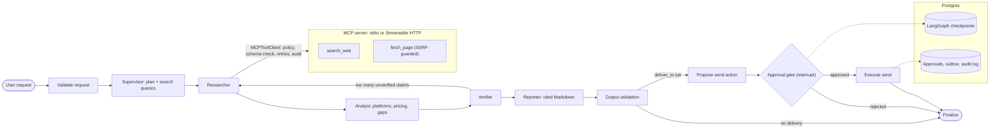

# TraceMind

**A multi-agent research system that turns a question into a cited competitor-analysis report, with tools served over MCP and a human approval gate before anything leaves the system.**

> **Video overview:** [Watch the 2-minute walkthrough](https://notebooklm.link.google/QOHeEj9ZwKXV)  
> **Live MCP server:** [`https://tracemind-mcp.onrender.com/mcp`](#try-the-mcp-server)  
> **Stack:** Python, LangGraph, MCP, Postgres, Docker

Ask: _"Research the top five AI interview platforms, compare their pricing and features, identify market gaps, and generate a competitor analysis report with sources."_

TraceMind plans the work, searches and reads the web through its own MCP server, extracts claims that are **grounded in verbatim page excerpts**, verifies them, loops back for more research when too many claims are weak, writes a report where every claim carries a citation, and pauses for a **reviewer's approval** before emailing it.

---

## Architecture



| Layer | What it does |
|---|---|
| **Orchestration** (`graph.py`) | LangGraph state machine with conditional routing, a bounded research loop (`max_research_rounds`) and a global step limit so a run can't spin forever. |
| **Agents** (`agents/`) | Supervisor, Researcher, Analyst, Verifier, Reporter. Each returns **Pydantic-validated structured output**; invalid output is retried with the validation error fed back. Prompts are versioned files (`prompts/v1_*.md` … `v3_*.md`). |
| **MCP server** (`mcp_servers/`) | `search_web`, `fetch_page` and `verify_citation` exposed as MCP tools. Runs over **stdio** for local use or **Streamable HTTP** for hosting, the same tools either way. |
| **MCP client** (`mcp_client.py`) | Per-agent tool allow-list, JSON-schema validation of arguments before the call, timeout + retry with backoff for transient failures only, and a per-invocation audit record (tool, agent, status, latency, attempts). |
| **Human-in-the-loop** (`approvals.py`, `agents/delivery.py`) | Outbound actions become an approval row pinned to a **SHA-256 of the exact report**. The graph `interrupt()`s and resumes from a Postgres checkpoint; execution re-checks the DB, so a tampered report or replayed decision is refused. |

## Engineering highlights

- **Grounded claims, not hallucinated ones.** The researcher drops any finding whose excerpt isn't literally present in the fetched page, and output validation rejects a report with missing sections, leftover citation markers or no citations.
- **SSRF-safe fetching.** `fetch_page` resolves the host and refuses private, loopback, link-local and cloud-metadata addresses (e.g. `169.254.169.254`), re-validates on every redirect, allows only `http/https` on ports 80/443, and caps body size and content types. The check runs **at connect time** inside a custom network backend that dials the vetted IP literal, so DNS-rebinding (public answer to the check, private answer to the socket) can't slip through, while TLS still verifies the real hostname.
- **Least privilege.** The tool server process only receives the search key, never the LLM key. `send_report` is a protected tool that no agent can call directly; it only runs through the approval path.
- **Approval integrity.** No self-approval (configurable), reviewer role check, row lock on decisions, replay rejection, idempotent outbox insert, and every decision and blocked execution written to an audit log.
- **Hosted MCP hardening.** Optional bearer token (constant-time compare), per-IP and global rate limits, DNS-rebinding protection via Host allow-list, stateless HTTP so it scales horizontally, and a non-root container.
- **Failure isolation.** Every node is wrapped so an exception becomes a recorded failed state instead of a crash, and one bad page never kills a research round.

## Try the MCP server

**Live endpoint:** `https://tracemind-mcp.onrender.com/mcp` (open demo, rate limited)

It exposes three tools:

| Tool | What it does |
|---|---|
| `verify_citation(url, quote)` | **Fact-checks a citation.** Fetches the page and reports `exact_match`, `normalized_match` (only case, quote-style or dash differences), `close_match` (similar but altered; returns what the page actually says) or `not_found`. Add the server to your AI assistant and it can check its own quotes against the source. |
| `fetch_page(url)` | Fetches a public page and returns its title and readable text, behind SSRF and DNS-rebinding protection. |
| `search_web(query, max_results)` | Web search (Tavily). | The server runs on Render's free tier, so the first request after an idle period can take 30-60 seconds while it wakes up.

**Quickest: curl** (nothing to install). The server is stateless, so each call stands alone:
```bash
# List the tools
curl -s -X POST https://tracemind-mcp.onrender.com/mcp \
  -H "Content-Type: application/json" -H "Accept: application/json, text/event-stream" \
  -d '{"jsonrpc":"2.0","id":1,"method":"tools/list"}'
```
```bash
# Try the SSRF guard: ask it to read the cloud metadata endpoint
curl -s -X POST https://tracemind-mcp.onrender.com/mcp \
  -H "Content-Type: application/json" -H "Accept: application/json, text/event-stream" \
  -d '{"jsonrpc":"2.0","id":2,"method":"tools/call","params":{"name":"fetch_page","arguments":{"url":"http://169.254.169.254/latest/meta-data/"}}}'
# -> "isError": true, "non-public address: 169.254.169.254"
```
```bash
# Fact-check a citation: the number was changed, so it comes back as close_match with the real sentence
curl -s -X POST https://tracemind-mcp.onrender.com/mcp \
  -H "Content-Type: application/json" -H "Accept: application/json, text/event-stream" \
  -d '{"jsonrpc":"2.0","id":3,"method":"tools/call","params":{"name":"verify_citation","arguments":{"url":"https://docs.python.org/3/tutorial/index.html","quote":"Python is a hard to learn, powerful programming language."}}}'
```

**MCP Inspector** (visual UI, needs Node.js):
```bash
npx @modelcontextprotocol/inspector
```
Choose transport **Streamable HTTP**, URL `https://tracemind-mcp.onrender.com/mcp`, connection type **Via Proxy**, then Connect → Tools → List Tools.

Things to try:
- `verify_citation` with `https://docs.python.org/3/tutorial/index.html` and the quote `Python is an easy to learn, powerful programming language.`, then change a word and run it again
- `fetch_page` with `https://example.com/`: returns the page title and text
- `fetch_page` with `http://169.254.169.254/latest/meta-data/`: blocked (cloud metadata / SSRF)
- `fetch_page` with `http://127.0.0.1/` or `file:///etc/passwd`: blocked

**Cursor** (`~/.cursor/mcp.json`):
```json
{
  "mcpServers": {
    "tracemind": { "url": "https://tracemind-mcp.onrender.com/mcp" }
  }
}
```

**VS Code** (`.vscode/mcp.json`):
```json
{
  "servers": {
    "tracemind": { "type": "http", "url": "https://tracemind-mcp.onrender.com/mcp" }
  }
}
```

**Claude Desktop:** Settings → Connectors → Add custom connector → `https://tracemind-mcp.onrender.com/mcp`.

Limits on the public demo: 20 requests/min per visitor, 60/min overall, 30 searches/day. For your own instance with a token, see [Deploy the MCP server](#deploy-the-mcp-server).

## Run locally

Requires Python 3.11+ and Docker.

```bash
python -m venv .venv && source .venv/bin/activate
pip install -e ".[dev]"
cp .env.example .env          # fill in keys
docker compose up -d db       # Postgres for checkpoints + approvals
pytest -q                     # Postgres tests auto-skip if the DB is down
```

**MCP server over HTTP**
```bash
python -m tracemind.mcp_servers.http_app      # http://127.0.0.1:8000/mcp, health at /healthz
```

**Full agent pipeline** (needs `LLM_API_KEY` and `TAVILY_API_KEY`)
```bash
python scripts/run_demo.py --live
MCP_URL=http://127.0.0.1:8000/mcp python scripts/run_demo.py --live   # use the HTTP server instead of stdio
```

**Human-in-the-loop demo**: `scripts/hitl_demo.py` runs a task to the approval gate, then lets a reviewer approve or reject and resumes it from the checkpoint.

## Deploy the MCP server

The `Dockerfile` builds only the MCP server: no LLM key needed, non-root, health-checked.

```bash
docker build -t tracemind-mcp .
docker run -p 8000:8000 -e TAVILY_API_KEY=... -e MCP_AUTH_TOKEN=... \
  -e 'MCP_ALLOWED_HOSTS=["your-host.example.com"]' tracemind-mcp
```

| Setting | Purpose |
|---|---|
| `MCP_AUTH_TOKEN` | Bearer token. Leave empty only for an open demo. |
| `MCP_ALLOWED_HOSTS` | Your public hostname(s); requests with other `Host` headers get `421`. |
| `MCP_RATE_LIMIT_PER_MINUTE` / `MCP_GLOBAL_RATE_LIMIT_PER_MINUTE` | Per-IP and whole-instance limits. The global cap protects your search-API quota. |
| `MCP_TRUST_PROXY` | `true` behind a load balancer so the real client IP (last `X-Forwarded-For` hop) is rate-limited. |

**One-click on Render (free):** the repo ships a `render.yaml` blueprint. Dashboard → New → Blueprint → select this repo → paste `TAVILY_API_KEY`. Render's hostname, port and client-IP header are picked up automatically, and `SEARCH_DAILY_LIMIT` keeps a public demo inside the search API's free quota.

Other hosts: any container host works (Render, Fly.io, AWS App Runner, ECS Fargate). Rate limits are in-memory per instance; when running several replicas, also add throttling at the gateway or load balancer.

## Project layout

```
src/tracemind/
  graph.py            LangGraph wiring and routing
  agents/             supervisor, researcher, analyst, verifier, reporter, delivery, lifecycle
  prompts/            versioned system prompts
  mcp_servers/        web_server.py (tools, stdio)  ·  http_app.py (Streamable HTTP, auth, rate limit)
  mcp_client.py       policy-checked, schema-validated, retrying MCP client (stdio + HTTP)
  security/           URL / SSRF policy
  approvals.py, db.py, checkpoint.py   approval workflow, models, Postgres checkpointer
tests/                unit + integration tests (MCP over stdio and HTTP, SSRF, approvals, routing)
```
